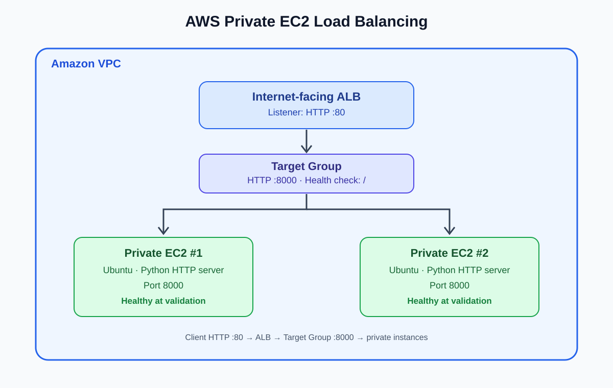

# AWS VPC with Private EC2 Instances and an Application Load Balancer

A hands-on AWS networking lab that routes HTTP requests through an internet-facing Application Load Balancer (ALB) to two EC2 instances hosted in private subnets.

> **Project type:** Cloud infrastructure / networking lab  
> **Status:** Successfully tested — both registered targets reported **Healthy**, and a request through the ALB returned **HTTP/1.1 200 OK**.

## Scope and reference architecture

This repository documents the infrastructure actually tested in this lab: an ALB, a target group, and two private EC2 instances serving a test page.

The design reference is AWS's official **VPC with servers in private subnets and NAT** example. That broader production-style architecture includes public and private subnets across two Availability Zones, an Auto Scaling group, an ALB, and a NAT gateway in each AZ so private instances can initiate outbound internet connections with improved AZ-level resiliency.

**Scope accuracy:** An Auto Scaling group and two NAT gateways were not verified as part of this completed lab, so they are documented as production-architecture extensions rather than completed resources.

Reference: [AWS — Example: VPC with servers in private subnets and NAT](https://docs.aws.amazon.com/vpc/latest/userguide/vpc-example-private-subnets-nat.html).

## Architecture



**Request flow:** Client → ALB listener (HTTP :80) → Target Group (HTTP :8000) → Private EC2 instances.

## AWS components

- Amazon VPC and subnets
- Internet-facing Application Load Balancer
- HTTP listener on port `80`
- Target group forwarding to port `8000`
- Two private EC2 instances running Ubuntu
- Security groups and target-group health checks
- Python `http.server` for basic connectivity testing

## Validation evidence

The following were verified during the lab:

- Both registered EC2 targets reached **Healthy** status.
- A request to the ALB DNS endpoint returned **HTTP/1.1 200 OK**.
- The response body contained the test webpage HTML.
- Requests reached the Python HTTP server on the target instances.

Add your own screenshots to the `screenshots/` directory and link them below.

### Target group health


### Successful HTTP response through the ALB


### Application page


## Implementation summary

1. Created the VPC/subnet networking and EC2 instances.
2. Configured an internet-facing ALB and an HTTP listener on port `80`.
3. Registered both private EC2 instances in a target group using port `8000`.
4. Started a Python HTTP server on each instance to serve a simple HTML page.
5. Checked target-group health and verified the ALB response with `curl.exe`.

## Test the endpoint

The lab endpoint was tested during the session:

```powershell
curl.exe -v --max-time 10 http://<your-alb-dns-name>/
```

Expected result: `HTTP/1.1 200 OK` and the HTML response.

**Do not rely on the endpoint staying online.** This was a learning environment. The Python servers were started interactively and stop if their processes stop; AWS resources may also be deleted after the screenshots are captured.

## Troubleshooting lessons

- A target can be unhealthy if no process is listening on the configured target port.
- A successful health check proves the ALB can reach the target, but client-to-ALB access should be tested separately.
- Use `curl`/`curl.exe` to distinguish a TCP connection issue from an HTTP response issue.
- Verify the listener port, target-group port, health-check path, and security-group rules as a connected set.
- Troubleshoot one layer at a time and avoid changing multiple settings without evidence.

## Security notes

- Do not commit `.pem` files, AWS credentials, account IDs if your policy treats them as sensitive, or other secrets.
- Restrict inbound traffic to the application port to the ALB security group rather than `0.0.0.0/0`.
- Allow public HTTP/HTTPS only where intended.
- Python's built-in HTTP server is for testing, not production workloads.

## Production architecture improvements

To align this lab with the full AWS reference architecture:

- Create public and private subnets in at least two Availability Zones.
- Place one NAT gateway in each AZ and route each private subnet to its local NAT gateway.
- Create a launch template and an EC2 Auto Scaling group spanning both private subnets.
- Attach the Auto Scaling group to the ALB target group so instances can register and deregister automatically.
- Restrict inbound application traffic to the ALB security group.

These are planned extensions, not claims that they were completed in this lab.

## Future improvements

- Rebuild the infrastructure with Terraform.
- Configure application startup using EC2 user data or `systemd`.
- Add HTTPS using AWS Certificate Manager.
- Add CloudWatch metrics, logs, and alarms.
- Add a GitHub Actions workflow for validation or deployment.

## Repository contents

- `architecture.svg` — editable text-based architecture diagram
- `screenshots/` — place your real AWS console and terminal screenshots here
- `commands/setup-notes.md` — notes for documenting commands and configuration

---
Built as a hands-on AWS learning project focused on cloud networking, load balancing, health checks, and troubleshooting.
